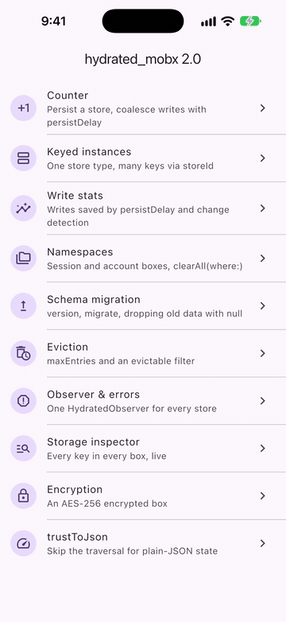
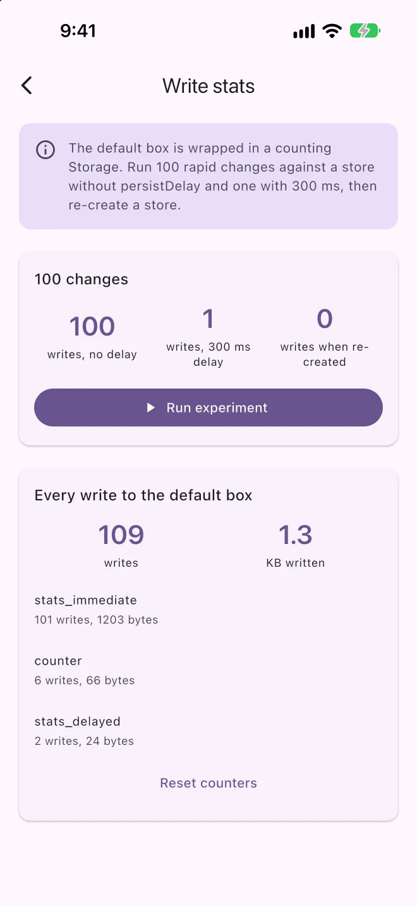
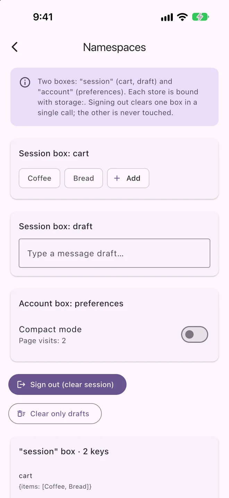
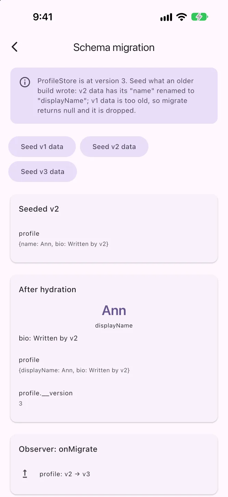
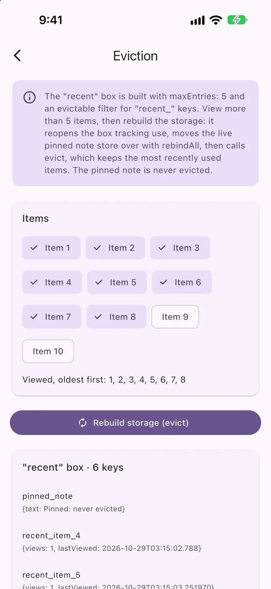
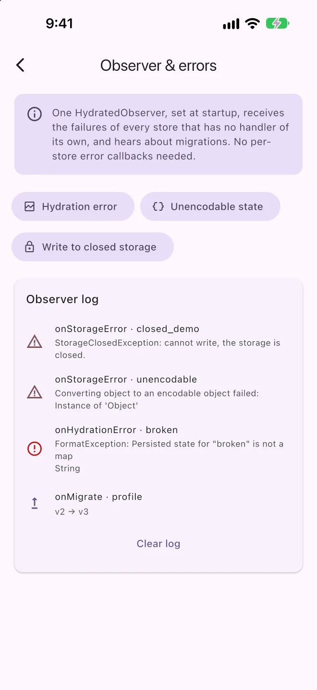
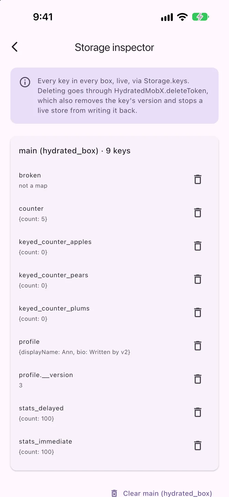

# HydratedMobX

Persist and restore MobX stores automatically. A store extends `HydratedMobX`,
says how to turn its state into JSON and back, and survives app restarts.

> This package started from code in [hydrated_bloc](https://pub.dev/packages/hydrated_bloc)
> by Felix Angelov (MIT). Thanks to its authors.

<p align="center">
  
</p>

| | | |
| :-: | :-: | :-: |
|  |  |  |
| Writes saved by `persistDelay` and change detection | Session and account boxes | `migrate` renames a field |
|  |  |  |
| `maxEntries` keeps the 5 latest | One observer for every store | Every key in every box |

The screens come from the [example app](example), one per feature.

## Features

- Restores a store's state when it is created and saves every change.
- **Write coalescing:** `persistDelay` turns a burst of changes into one write;
  `flush()` / `flushAll()` write the pending state on demand.
- **No redundant writes:** a change that leaves the JSON as it was is not
  written, and neither is the state a store just hydrated.
- **Several storages:** one Hive box per namespace (session, account, cache),
  each store bound to the one it belongs in.
- **Targeted clearing:** `clearAll(where:)` deletes only the tokens you name, in
  one operation, and stops their stores first.
- **Eviction:** `maxAge` and `maxEntries` keep per-id caches from growing
  forever.
- **Schema versions:** `version` + `migrate`, which can also drop old data.
- **One error hook:** `HydratedMobX.observer` sees every store's hydration and
  write failures, and every migration.
- Encryption (AES-256), every platform Hive supports, an `InMemoryStorage` for
  tests, and `importData` for moving data in from another layer.

## Benchmarks

`dart run benchmark/persistence_benchmark.dart`, the same scenarios run against
1.2.0. Apple M4 Pro, Dart 3.13 JIT, Hive on the local SSD.

| Scenario | 1.2.0 | 2.0.0 |
| --- | --- | --- |
| 1000 rapid changes to one store | 1000 writes | 1000 writes, or **1** with `persistDelay: 100ms` |
| Re-creating a hydrated store 100 times | 100 writes | **0** writes |
| One change to a 2000-row state, time blocking the caller | 1.15 ms | 0.97 ms, **0.41 ms** with `trustToJson` |
| 500 per-id cache keys | kept forever | **50** kept with `maxEntries: 50` |

## Getting started

```yaml
dependencies:
  hydrated_mobx: ^2.0.0
```

Build the storage before `runApp`:

```dart
Future<void> main() async {
  WidgetsFlutterBinding.ensureInitialized();
  HydratedMobX.storage = await HydratedStorage.build(
    storageDirectory: kIsWeb
        ? HydratedStorageDirectory.web
        : HydratedStorageDirectory(
            (await getApplicationSupportDirectory()).path,
          ),
  );
  runApp(const App());
}
```

Upgrading from 1.x? Keep the directory you built the storage in before. The
1.x docs used `getApplicationDocumentsDirectory()`; a different directory opens
an empty box, and every store starts from its defaults.

## A hydrated store

```dart
part 'counter_store.g.dart';

class CounterStore = _CounterStore with _$CounterStore;

abstract class _CounterStore extends HydratedMobX with Store {
  @observable
  int count = 0;

  @action
  void increment() => count++;

  @override
  String get storagePrefix => 'counter';

  @override
  Map<String, dynamic>? toJson() => {'count': count};

  @override
  void fromJson(Map<String, dynamic> json) => count = json['count'] as int;
}
```

- `storagePrefix` is the store's fixed name on disk. It is required: a name
  taken from the class would change with a rename or an obfuscated build, and
  the stored state would be lost. Two store types must not share one.
- The store hydrates in its constructor, before your constructor body runs, so
  `toJson` and `fromJson` may only use fields set by initializers.
- `toJson` returning `null` skips the write.

### Several instances of one store

Give each instance its own key with `storeId` (or override `id`). The key is
`'$storagePrefix${storeId ?? id}'`.

```dart
abstract class _ThreadStore extends HydratedMobX with Store {
  _ThreadStore(this.threadId) : super(storeId: threadId);

  final String threadId;

  @override
  String get storagePrefix => 'thread_';
  // ...
}
```

## Writing less

### Coalescing with `persistDelay`

Every change is written right away by default. With a `persistDelay`, changes
made within that window are written once, when it ends:

```dart
_DraftStore() : super(persistDelay: const Duration(milliseconds: 300));
```

Set `HydratedMobX.defaultPersistDelay` to apply one to every store built
without its own.

A coalesced change is lost if the process dies inside the window, so write the
pending state when the app goes to the background:

```dart
AppLifecycleListener(onPause: () => HydratedMobX.flushAll());
```

`store.flush()` does the same for one store, and completes when the write has
finished. `dispose()` starts a pending write instead of dropping it.

### Unchanged state is not written

Before writing, the store compares the new JSON with the JSON it last wrote or
hydrated, and skips the write when they are equal. Opening a cached screen
therefore costs a read and no write.

### `trustToJson` for large states

Before writing, the store walks the JSON your `toJson` returned: it calls
`toJson()` on objects it meets and copies the result. When your `toJson`
already returns plain JSON, skip that walk:

```dart
@override
bool get trustToJson => true;

@override
Map<String, dynamic>? toJson() => {
      'page': _page.toJson((post) => post.toJson()),
    };
```

Plain JSON means only `null`, `bool`, `num`, `String`, `List` and
`Map<String, ...>`, built fresh on each call. Returning a collection the store
keeps and later mutates breaks the comparison above.

With json_serializable, set `explicit_to_json: true` so nested objects come out
as maps. A generic DTO's `toJson` takes a converter, which the walk cannot
supply; call it yourself, as above, rather than round-tripping through
`jsonEncode`/`jsonDecode`.

### What `fromJson` receives

`fromJson` gets a fresh, deep copy of the stored state: every nested map is a
`Map<String, dynamic>` and every list a `List<dynamic>`, whatever Hive returned.
Pass the parts straight to json_serializable factories; there is no need to
round-trip through `jsonEncode` first.

The `HydratedJson` helpers read fields with safe defaults (`readList`,
`readObject`, `readStringList`, `readString`, `readInt`, `readDouble`,
`readBool`, `writeList`).

## Errors

Persistence runs in the background, so failures do not reach your code. Set an
observer once to see them all:

```dart
class CrashReportingObserver extends HydratedObserver {
  @override
  void onStorageError(HydratedMobX store, Object error, StackTrace stack) =>
      FirebaseCrashlytics.instance.recordError(error, stack,
          reason: 'persist ${store.storageToken}');

  @override
  HydrationErrorBehavior onHydrationError(
    HydratedMobX store,
    Object error,
    StackTrace stack,
  ) {
    FirebaseCrashlytics.instance.recordError(error, stack);
    return HydrationErrorBehavior.overwrite;
  }
}

HydratedMobX.observer = CrashReportingObserver();
```

- `onStorageError` covers failed writes and states that cannot be serialized.
- `onHydrationError` decides what happens after a failed read: `overwrite`
  (default) lets new changes replace the stored state, `retain` keeps it and
  stops writing until the next successful `hydrate()`.
- `onMigrate` hears about every migration.

A store that passes its own `onStorageError` or `onHydrationError` handles its
failures itself instead.

Using a storage after `close()` throws `StorageClosedException`, which reaches
the same handlers.

## Several storages

Build one storage per namespace, each with its own `boxName`, and bind stores
with `storage:`. Clearing one never touches another.

```dart
final session = await HydratedStorage.build(
  storageDirectory: directory,
  boxName: 'session',
);
final account = await HydratedStorage.build(
  storageDirectory: directory,
  boxName: 'account',
);

class OutboxStore extends _OutboxStore with _$OutboxStore {
  OutboxStore(Storage accountStorage) : super(storage: accountStorage);
}

// On sign-out:
await HydratedMobX.clearAll(storage: session);
```

The storage is a constructor parameter, so it works with dependency injection
and with test doubles. Stores built without one use `HydratedMobX.storage`.

## Clearing state

| Call | Deletes | Stops persisting |
| --- | --- | --- |
| `store.clearPersisted()` | that store's state | that store (`resume: true` keeps it going) |
| `HydratedMobX.clearAll(storage: s)` | everything in `s` | every store bound to `s` |
| `HydratedMobX.clearAll(where: (token) => ...)` | the matching tokens | the matching stores |
| `HydratedMobX.deleteToken('token')` | one token | its store, if live |
| `store.dispose()` | nothing | that store, for good |

Every call also deletes the version keys of what it deletes, and drops writes
already scheduled, so cleared state cannot come back. `clearAll(where:)`
deletes in a single `deleteAll`, so the keys you keep are never rewritten.

`HydratedMobX.versionKeyOf`, `isVersionKey` and `tokenOfKey` map between a
store's token and the `.__version` key kept beside versioned state.

Call `dispose()` when a store's owner goes away (a widget's `dispose`, a DI
scope's teardown). A persisting store is kept alive by its MobX reaction, and
`dispose()` releases it.

## Eviction

Per-id stores (one per user, per thread, per item) add a key each and are
never deleted on their own. Bound them when building the storage:

```dart
final cache = await HydratedStorage.build(
  storageDirectory: directory,
  boxName: 'cache',
  maxAge: const Duration(days: 30),
  maxEntries: 200,
  evictable: (key) => key.startsWith('profile_'),
);
```

- `maxAge` deletes keys not hydrated or written for that long. A plain
  `storage.read` does not count, so an inspector screen keeps nothing alive.
- `maxEntries` then keeps only the most recently used keys.
- `evictable` limits both to the keys it accepts.

Eviction runs when the storage is built, before any store reads from it.
`storage.evict(...)` runs it again later, and stops the live stores of the keys
it deletes. Only a storage built with `maxAge`, `maxEntries` or
`trackUse: true` records use times, in a small companion box; other storages
pay nothing for eviction. A key's use time is rewritten at most once per
`useResolution` (a minute by default). Keys written before 2.0 count as used at
the first 2.0 launch. Keep the eviction settings the same across launches:
keys written while use times were not tracked look as old as their last
recorded use.

`compactionStrategy` tunes when Hive rewrites the box file.

## Schema versions

Bump `version` when the shape of `toJson` changes, and upgrade older data in
`migrate`. Return `null` to drop data too old to carry forward:

```dart
@override
int get version => 3;

@override
Map<String, dynamic>? migrate(int oldVersion, Map<String, dynamic> old) {
  if (oldVersion < 2) return null; // v1 cannot be read any more
  if (oldVersion < 3) old['count'] = old.remove('counter') ?? 0;
  return old;
}
```

- `migrate` runs during hydration when the stored version is lower. Its result
  goes to `fromJson` and is written under the new version, which is recorded
  only after the state, so a crash re-runs the migration instead of skipping
  it.
- Returning `null` deletes the stored state; `fromJson` is not called.
- Data written before versioning existed counts as version 1.
- Apply each step with stacked `if (oldVersion < N)` blocks. Dart `switch`
  cases do not fall through.

## Importing data

Seed a storage from another persistence layer before building the stores that
read it. Keys are store tokens.

```dart
final prefs = await SharedPreferences.getInstance();
await HydratedMobX.importData({
  'counter': {'count': prefs.getInt('count') ?? 0},
});
```

Existing keys are kept unless `overwrite: true`. Pass `version:` when the data
is already in a newer schema, so it is not migrated again; `storage:` targets a
storage other than the global one.

## Encryption

```dart
final key = sha256.convert(utf8.encode(password)).bytes;
HydratedMobX.storage = await HydratedStorage.build(
  storageDirectory: directory,
  encryptionCipher: HydratedAesCipher(key),
);
```

Hive encrypts values, not keys: a store's token (`storagePrefix` plus its id)
is readable in the box file. Keep secrets out of `storeId`s.

## Testing

```dart
setUp(() => HydratedMobX.storage = InMemoryStorage());
```

Or pass `storage: InMemoryStorage({'counter': {'count': 3}})` to the store
under test to start it from a known state.

## Wrapping or writing a storage

To wrap a storage (count, log or delay writes), extend `ForwardingStorage` and
override what you need. It forwards everything to `inner`, suspends its own
stores on `clear`, and passes eviction use times through.

```dart
class LoggingStorage extends ForwardingStorage {
  LoggingStorage(super.inner);

  @override
  Future<void> write(String key, dynamic value) {
    debugPrint('write $key');
    return super.write(key, value);
  }
}
```

Storage calls and observer callbacks run untracked, so a storage or observer
may read MobX observables without the persistence reaction depending on them.

To write one from scratch, implement `Storage`: `read`, `write`, `delete`,
`deleteAll`, `keys`, `clear` and `close`. `read` is synchronous, because stores
hydrate in their constructor. From `clear`, call
`HydratedMobX.suspendAll(storage: this)` before wiping, so no store writes its
state back. Implement `UseTrackingStorage.markUsed` to take part in eviction.

### Rebuilding a storage

To close a storage and open it again while stores are live, move them over:

```dart
await HydratedMobX.flushAll(storage: cache);
await cache.close();
final reopened = await HydratedStorage.build(
  storageDirectory: directory,
  boxName: 'cache',
  trackUse: true,
);
HydratedMobX.rebindAll(from: cache, to: reopened);
await reopened.evict(maxEntries: 200);
```

Evict after `rebindAll`, not while building: eviction stops the live stores of
the keys it deletes, and only once they are bound to the new storage.

## Performance notes

- Each change runs `toJson` and the comparison on the calling isolate; the
  Hive write itself is asynchronous. Use `persistDelay` for stores that change
  often, and `trustToJson` for large ones.
- `HydratedStorage` keeps its box in memory, which is what makes `read`
  synchronous. Keep caches bounded with eviction rather than storing
  everything in one box.
- hive_ce's `IsolatedHive` is not used: its reads are asynchronous, which a
  constructor-time hydration cannot wait for, and every write would still copy
  the whole state to the other isolate from the calling one.

## Example app

[`example/`](example) has one screen per feature:

| Screen | Shows |
| --- | --- |
| Counter | A store that survives a restart; `persistDelay` and `flush()` |
| Keyed instances | One store type, one key per `storeId` |
| Write stats | Writes counted through a `ForwardingStorage`: 100 changes, 1 write |
| Namespaces | Session and account boxes; sign-out clears one; `clearAll(where:)` |
| Schema migration | Seeding old data with `importData`; `migrate` upgrading or dropping it |
| Eviction | A per-item cache bounded by `maxEntries` and `evictable` |
| Observer & errors | Hydration, serialization and closed-storage errors in one log |
| Storage inspector | Every key in every box, with delete and clear |
| Encryption | An AES-256 box; the note is not in the file as plain text |
| trustToJson | Time per write of a 2000-row state, with and without it |

```sh
cd example
flutter run
```

## Migrating from 1.x

| 1.x | 2.0 |
| --- | --- |
| `storagePrefix` defaults to `runtimeType` | Required. Return the old class name (e.g. `'CounterStore'`) to keep reading 1.x data. |
| `store.clear({resume})` | `store.clearPersisted({resume})` |
| `Map<String, dynamic> migrate(...)` | `Map<String, dynamic>? migrate(...)`; `null` drops the data |
| `defaultOnHydrationError`, `defaultOnStorageError` | `HydratedObserver`; per-store handlers are optional |
| `Storage` had 5 members | Add `deleteAll` and `keys`; call `HydratedMobX.suspendAll(storage: this)` from `clear` |
| `HydratedMobX.disposeAllForClear()` | `HydratedMobX.suspendAll(storage: ...)` |
| A closed storage ignored writes and read as empty | Reads, writes and `keys` throw `StorageClosedException`; store failures go to the error handlers |
| `HydratedStorage.hive` (testing hook) | Removed; each storage has its own Hive instance |
| `.hydrated_bloc.json` imported at build | Removed; use `importData` |
| Every change and every construction wrote | Unchanged state is not written |

Stored data needs no conversion: 1.x boxes open as they are, under the default
`boxName`, as long as the storage is built in the same directory as before.

## More

- [MobX documentation](https://mobx.netlify.app/)
- [Issues and feature requests](https://github.com/NarekManukyan/hydrated_mobx/issues)
